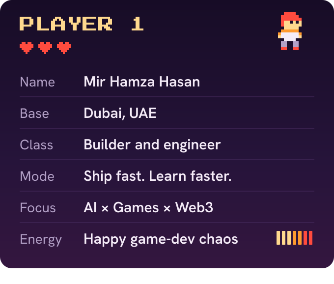

  

    

## About me

I'm a Dubai-based developer building at the intersection of **AI systems, game technology, backend engineering, automation and Web3 infrastructure**.

I like turning rough ideas into shipped products: tools that save time, games that feel fun, systems that scale, and automation that removes boring work.

I've shipped mobile games with **millions of installs**. Now I'm focused on AI-powered developer tools, realtime blockchain systems, and products people actually enjoy using.

 

## Game dev

## Blockchain

## What I'm building

## Projects

**[TradeBlocks](https://tradeblocks.xyz)** is automated market making and trading execution for token founders and DAOs.

**[DracoArts AI-Based ASO](https://github.com/MirHamzaHasan/open-source-ai-aso-tool-free)** is an open-source App Store Optimization toolkit for keyword research, competitor tracking and listing writing. It's built with Next.js and works with Claude, OpenAI, Gemini, DeepSeek and Ollama.

## My stack

## A year of commits

One tower for each week, redrawn every day from my public GitHub activity.

## What I care about

- Build useful products, not just repositories.
- Make tools that save people time.
- Keep game-dev creativity inside serious engineering.
- Automate the boring parts.
- Ship, learn, improve, repeat.

 

